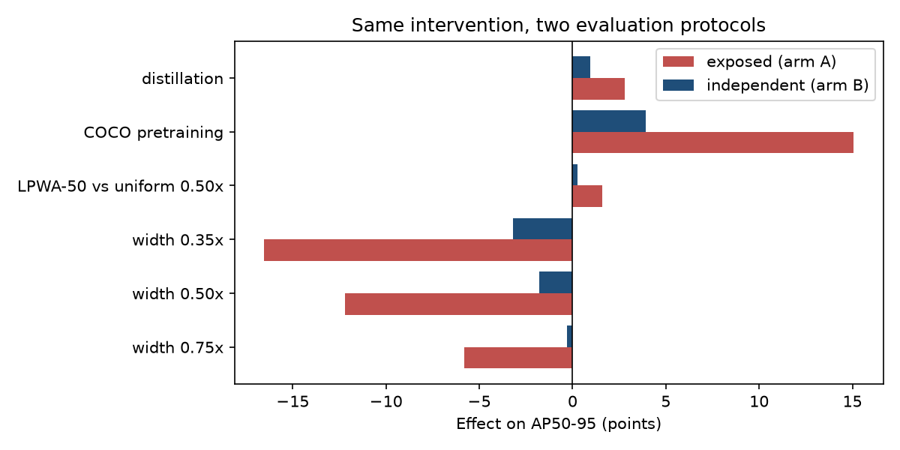
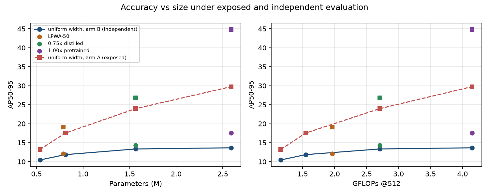

<div align="center">

# Beyond Metric Inflation

### Source-family exposure distorts compression, pretraining and distillation conclusions in tomato disease detection

[](LICENSE)
[](docs/WEIGHTS.md)
[](pyproject.toml)
[](https://github.com/ultralytics/ultralytics)
[](#evidence-standards)

**Paper in preparation** · [Results in detail](docs/RESULTS.md) · [Weights](docs/WEIGHTS.md) · [Dataset notes](DATASET.md)

</div>

---

**TL;DR.** Plant-disease benchmarks often ship augmented copies of every photo and split at the file level, so test
images have near-twins in training. We show this does more than inflate scores:
- it **biases every design comparison**: compression, architecture, pretraining and distillation;
- it **changes which detector you would deploy**.

Measured without leakage, the compact detectors mostly **miss lesions** rather than misname them.
Localization-focused distillation partly repairs this.

<p align="center">
  
</p>

## Highlights

**1. Exposure distorts every intervention.** Six-class AP50-95, YOLO11n, 5 paired seeds:

| Intervention | Independent eval | Exposed eval | Distortion |
|---|---:|---:|---:|
| Shrink width to 0.75× | −0.31 | −5.79 | −5.5 |
| Shrink width to 0.50× | −1.80 | −12.22 | −10.4 |
| Shrink width to 0.35× | −3.20 | −16.54 | −13.3 |
| Width reallocation (LPWA-50) | +0.26 | +1.58 | +1.3 |
| COCO pretraining | +3.93 | +15.07 | +11.1 |
| Localization distillation | +0.95 | +2.81 | +1.9 |

**2. The deployment decision flips.** Under one frozen selection rule:

| Validation | Selected model |
|---|---|
| Independent | **0.75× (1.57 M params)** |
| Exposed | **1.00× (2.59 M)**: every reduced width is rejected |

**3. Missed lesions dominate.**
- About half of ground-truth lesions get no nearby detection.
- Disease confusions are under 2 per 100 lesions.
- Compression mostly adds misses, hitting small lesions hardest in relative terms.

**4. Distillation repairs part of the gap.** Box-distribution and P3/P4 attention distillation raises the 0.75× model
by **+0.95 AP** [0.21, 1.69], with no change to its architecture.

**5. Locked test**, run once after every decision was frozen:

| Model | Params | Test AP50-95 |
|---|---:|---:|
| YOLO11n 1.00×, COCO-pretrained | 2.59 M | **17.27 ± 0.39** |
| **YOLO11n 0.75×, distilled (selected)** | **1.57 M** | **16.08 ± 0.96** |
| YOLO11n 1.00×, from scratch | 2.59 M | 16.19 ± 0.69 |
| YOLO11n 0.75×, from scratch | 1.57 M | 14.95 ± 0.98 |

<p align="center">
  
  <br><sub>Accuracy vs size. Circles: independent evaluation. Squares: source-exposed evaluation.</sub>
</p>

## The leakage, in one picture

```
one source photo ──► original + 7 augmented copies (flip, rotate, crop, recolour)
                              │
      official split: files shuffled individually
                              ▼
   train: copy 1, copy 3, copy 6 …   validation: copy 2, copy 5 …   ← same leaf on both sides
```

Every one of the **2,875** official validation files has a sibling in training. We regroup files by source photo,
merge near-duplicates, and split by family. See [DATASET.md](DATASET.md).

## Quick start

```bash
git clone https://github.com/abdulsamad2/tomato-adcf-yolo && cd tomato-adcf-yolo
uv sync && uv pip install statsmodels pandas
uv run pytest -q                                            # unit + end-to-end smoke tests

# data (third-party, fetched from the authors at the exact commit we used)
uv run tv-download --commit dfc246014558293987b381c1edb49398d9f570ac
uv run tv-prepare --manifest splits/split_manifest.csv      # rebuilds our family-aware split

# trained weights (20 locked-test checkpoints, SHA-256 verified)
python tools/download_weights.py
```

Run the selected model:

```python
from ultralytics import YOLO
YOLO("weights/yolo11n-w075-distilled_seed0.pt").predict("leaf.jpg", imgsz=512, conf=0.25)
```

## Reproducing the paper

| Goal | How | Time |
|---|---|---|
| Re-score the locked test from the released weights | `python tools/download_weights.py`, then `python tools/rescore_locked_test.py --out rescored/` | minutes (GPU) |
| Re-train any phase | `tools/relocate_paths.py`, then the phase scripts in [`experiments/`](experiments/README.md) | Phase 15 ≈ 12 h, Phase 16A ≈ 3 h, Phase 17 ≈ 4 h (one RTX 5000 Ada) |
| Check that the code is what was frozen | Compare hashes in `experiments/MANIFEST.json` with each pre-registration | instant |

Phase scripts are kept **byte-identical** to the versions that ran; all 26 pre-registered hashes match. They
hard-code the original working folder, so `tools/relocate_paths.py` writes a runnable copy for your machine.

## Evidence standards

| Status | What it covers | Where |
|---|---|---|
| **Pre-registered** | Width non-inferiority (Phase 15), LPWA-50 gate (16A), distillation gate (17): rules, margins and script hashes frozen before training | `artifacts/phase15–17/` |
| **Locked test** | 4 models × 5 seeds, evaluated once, no gate and no selection | `artifacts/clean_test/` |
| **Post-hoc, plan hashed** | Error decomposition, IoU sweep, lesion size, operating curves, calibration; development data only | `artifacts/posthoc/` |
| **Exploratory** | Pretraining contrast, size thresholds, per-class and copy-type breakdowns | labelled in [RESULTS.md](docs/RESULTS.md) |

**Test-set disclosure.** The test split was scored earlier for models outside this study, during the original
ADCF exploration. It is therefore *held out from all models and decisions reported here*, not "never opened".

## Repository layout

```
├── README.md · DATASET.md · LICENSE · CITATION.cff
├── src/adcf_yolo/        data download, family-aware split, original ADCF pipeline
├── splits/               split_manifest.csv (file names and split assignments only)
├── configs/              shared training configuration
├── experiments/          9 numbered steps, scripts byte-identical to what ran, plus MANIFEST.json
├── artifacts/            pre-registrations, freeze records, evaluation rows, statistics, figures, weights manifest
├── results/              per-phase result tables
├── tools/                download_weights.py · rescore_locked_test.py · relocate_paths.py
├── docs/                 RESULTS.md (full results) · WEIGHTS.md
└── tests/                unit and end-to-end tests
```

## Data and licences

| Component | Licence |
|---|---|
| Code | MIT, see [LICENSE](LICENSE) |
| Weights | **AGPL-3.0**: trained with Ultralytics YOLO11, and the pretrained models start from Ultralytics' COCO weights |
| Dataset | **Tomato-Village**, by Gehlot, Saxena and Gandhi. **Not redistributed here:** its repository declares no licence. Download it from the authors with `tv-download` and cite their paper. |

## Citation

```bibtex
@misc{beyond_metric_inflation_2026,
  title  = {Beyond Metric Inflation: Source-Family Exposure Distorts Compression, Pretraining and
            Distillation Conclusions in Tomato Disease Detection},
  author = {abdulsamad2},
  year   = {2026},
  url    = {https://github.com/abdulsamad2/tomato-adcf-yolo}
}

@article{gehlot2023tomatovillage,
  title   = {"Tomato-Village": a dataset for end-to-end tomato disease detection in a real-world environment},
  author  = {Gehlot, M. and Saxena, R. K. and Gandhi, G. C.},
  journal = {Multimedia Systems},
  year    = {2023},
  doi     = {10.1007/s00530-023-01158-y}
}
```
